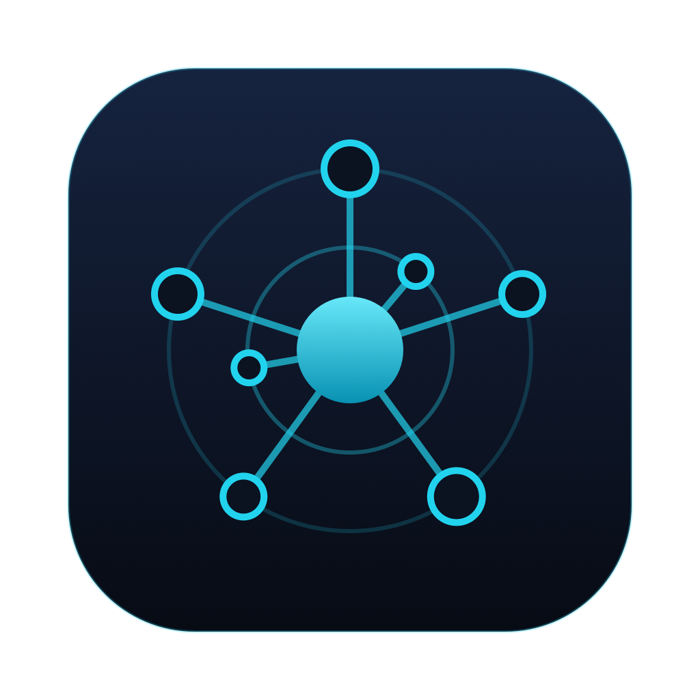
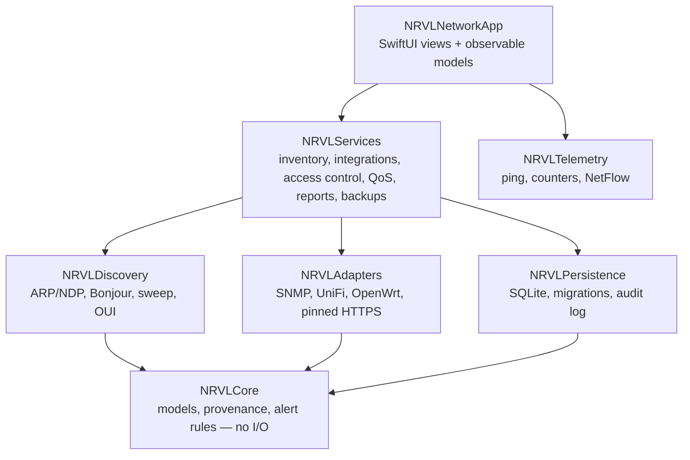

<div align="center">



# NRVL Network

**A native macOS command centre for the networks you own or administer.**

Discover every device, watch latency and traffic, see what is attached where, and — through your router's own documented interface — block devices and shape traffic. Free and open source.

[](https://github.com/princenrvl/nrvl-network/actions/workflows/ci.yml)
[](LICENSE)


[](CONTRIBUTING.md)

</div>

---

> [!IMPORTANT]
> **Status: early preview (0.1.0).** Local discovery, monitoring, alerts and reports work today on a real network. The router integrations (SNMP, UniFi, OpenWrt) pass their tests against *simulated* devices but **have not yet been verified on real hardware**. If you own the hardware, [a test report](https://github.com/princenrvl/nrvl-network/issues/new?template=hardware_report.yml) is the most valuable contribution you can make.

## Why

Most network tools are either a web dashboard in a wrapper, or tied to one vendor. NRVL Network is a real Mac app — Swift 6, SwiftUI, no Electron — that works the moment you open it and gets more capable as you connect your infrastructure.

It is built on three rules:

- **Real data only.** Every value shows where it came from and whether it is *confirmed* or *inferred*. If there is no source, the app says so instead of showing a number.
- **No attack techniques.** No ARP spoofing, deauthentication or packet interception — ever. Devices are blocked only by asking your router through its documented API.
- **Nothing is assumed.** Capabilities are probed per device. A change counts as done only after the router, read back, confirms it.

## Features

### Works out of the box — no router access needed

| | |
|---|---|
| **Overview** | Health with its reason, latency / jitter / packet loss to gateway and internet, live throughput |
| **Devices** | IP, MAC, manufacturer (IEEE registry), Bonjour name / model / services, evidence-based device type, first and last seen, connection history; rename, tag, group, mark trusted |
| **Topology** | Internet → gateway → subnets → devices, drawn only from evidence |
| **Networks & Subnets** | Interfaces, CIDR, DNS, IP allocation grid, possible address conflicts |
| **Traffic Analytics** | Stored history of throughput, latency and loss; opt-in NetFlow v5 collector for protocol / port / destination breakdowns |
| **Security Center** | New devices, gateway or DNS changes, address conflicts, certificate changes — reported as observations with their evidence |
| **Monitoring** | 13 alert types, thresholds, native notifications, alert history |
| **Reports** | Daily / weekly / monthly reports, PDF and CSV export, tamper-evident audit log |

### With a router integration

| Integration | Reads | Changes |
|---|---|---|
| **SNMP v2c** (switches, routers, APs) | Clients, switch port per device, subnets, per-interface traffic | — (read-only by design) |
| **Ubiquiti UniFi** (official Integration API) | Clients, wired / wireless, uplink device, infrastructure | — (the official API offers none) |
| **OpenWrt** (ubus) | Hosts, DHCP names, Wi-Fi clients and SSID, networks, firewall rules, config snapshots | Block / pause / schedule device access; SQM link shaping with rollback |

Every integration starts **read-only**. Changes need management switched on, a preview, and Touch ID or your password — and each attempt lands in the audit log.

### What it deliberately cannot do

A Mac is one host on the network, not the network. Without a router integration it cannot see other devices' traffic or control them, and the app will not pretend otherwise. Features your hardware cannot do are shown as *unsupported*, with the reason.

## Install

**Requirements:** macOS 14 or later, Apple silicon or Intel.

### Download

1. Download **`NRVL-Network-0.1.0.dmg`** from the [latest release](https://github.com/princenrvl/nrvl-network/releases/latest).
2. Open it and drag **NRVL Network** to Applications.
3. The first time, macOS will refuse to open it, because this preview is not yet notarised by Apple. Open **System Settings → Privacy & Security**, scroll to the message about NRVL Network and click **Open Anyway**. You only do this once.

Prefer not to bypass Gatekeeper? Build it yourself — the result is identical and macOS trusts what you build locally.

### Build from source

Needs Xcode 16 or later; takes about two minutes.

```bash
git clone https://github.com/princenrvl/nrvl-network.git
cd nrvl-network
Scripts/build-app.sh
open "build/NRVL Network.app"
```

On first launch macOS asks for **Local Network** access, which device discovery needs. Nothing else is required: no administrator password, no helper, no account.

Prefer Xcode? Open `NRVLNetwork.xcodeproj` and run the **NRVL Network** scheme.

Full guide: **[docs/INSTALL.md](docs/INSTALL.md)** — permissions, adding integrations, certificate approval, troubleshooting.

## Security

- Runs as you. No privileged helper, no root, not even an administrator prompt.
- Secrets live in the macOS Keychain, never in the database, logs or exports.
- HTTPS with certificate pinning: a router's self-signed certificate is accepted only after you approve its fingerprint, and any later change is refused and raises an alert.
- Append-only, hash-chained audit log of every administrative action, including refused and failed ones.
- Router configuration snapshots are encrypted with AES-256-GCM.

Details, including what the app sends on your network and its known limits: **[docs/SECURITY.md](docs/SECURITY.md)**.
Found a vulnerability? Please [report it privately](SECURITY.md).

## Architecture

Seven Swift package targets with compiler-enforced layering. One third-party dependency ([GRDB](https://github.com/groue/GRDB.swift) for SQLite).



Adding a platform means implementing one protocol, `InfrastructureAdapter`, plus whichever optional capabilities the platform documents (`AccessControlling`, `LinkShaping`, `FirewallInspecting`, `ConfigurationExporting`).

| Document | What is in it |
|---|---|
| [docs/ARCHITECTURE.md](docs/ARCHITECTURE.md) | Layers, data model, security model, as-built notes |
| [docs/TECHNICAL_DECISIONS.md](docs/TECHNICAL_DECISIONS.md) | 50 decisions with their reasons and limits |
| [docs/PROGRESS.md](docs/PROGRESS.md) | Status per phase, test results, everything not yet verified |
| [docs/DEVELOPMENT_PLAN.md](docs/DEVELOPMENT_PLAN.md) | The 12 phases |
| [docs/PROJECT_SPEC.md](docs/PROJECT_SPEC.md) | The original product specification |

## Development

```bash
swift test               # 60 tests: parsers, engines, adapters against simulated devices
Scripts/build-app.sh     # universal app → build/NRVL Network.app
Scripts/smoke-test.sh    # launch the build and check it is healthy
Scripts/package.sh       # disk image → build/NRVL-Network-<version>.dmg
Scripts/update-oui.sh    # refresh the IEEE manufacturer registry
```

## Roadmap

- [ ] Verify SNMP, UniFi and OpenWrt on real hardware
- [ ] MikroTik RouterOS, OPNsense and pfSense adapters
- [ ] SNMP v3, LLDP topology, NetFlow v9 / IPFIX
- [ ] Per-device traffic and QoS where a platform documents it
- [ ] UI tests
- [ ] Notarised releases (needs an Apple Developer ID)
- [ ] Multiple sites

## Contributing

Contributions are welcome — code, hardware test reports, documentation and bug reports alike. Start with **[CONTRIBUTING.md](CONTRIBUTING.md)**. This project follows a [Code of Conduct](CODE_OF_CONDUCT.md).

## Responsible use

NRVL Network is for networks you own or are explicitly authorised to administer. Scanning or managing networks without permission may be illegal where you live.

## Credits

Created and maintained by **Prince NRVL** — [@princenrvl](https://github.com/princenrvl).

Built with [GRDB.swift](https://github.com/groue/GRDB.swift) by Gwendal Roué. Manufacturer names come from the public [IEEE Registration Authority](https://standards.ieee.org/products-programs/regauth/) OUI registry.

## Licence

[MIT](LICENSE) © 2026 Prince NRVL. Free to use, modify and share — for everyone, at no cost.
